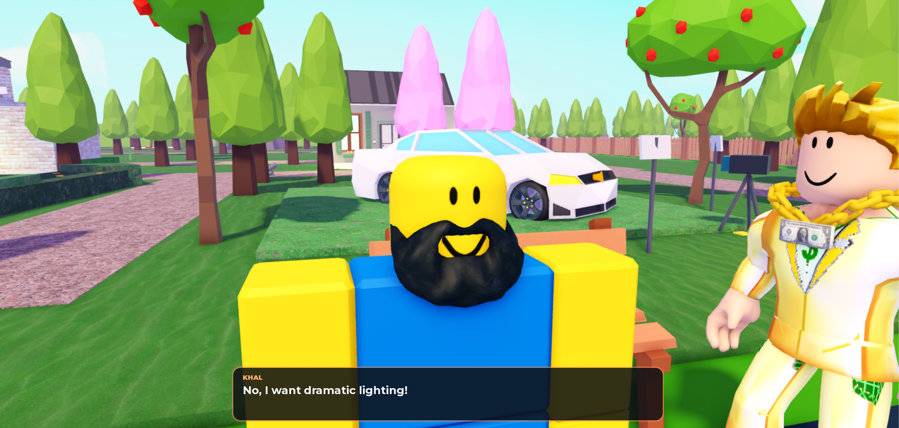
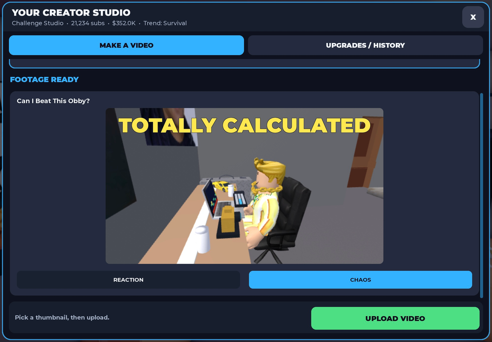
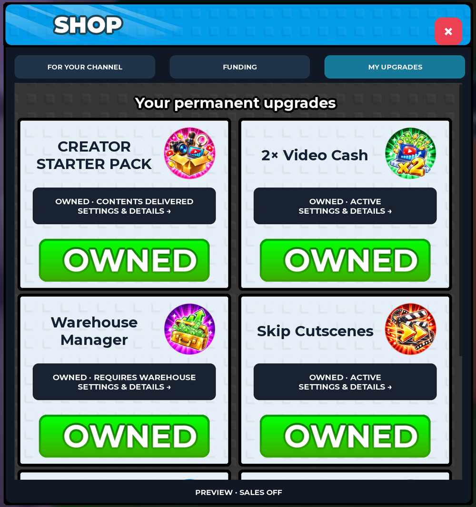

# MrBeast Simulator

A Roblox creator simulator.

MrBeast Simulator is a Roblox game where players grow a creator business. Plan a video, head out to film it, and upload the footage to earn in-game money and subscribers. Use those earnings to upgrade and unlock larger productions.

**Public release coming soon.** Currently in development and playtesting.

Shahin Madantschi · Twix Game Studios

[Roblox page](https://www.roblox.com/games/105829329945694/MrBeast-Simulator) · [Development notes](docs/engineering.md) · [Credits](docs/credits.md)

*Filming a scene with a participant who has a few requests.*

## The game

Film challenges, host a festival, and manage each video from the creator computer. Productions include participants, dialogue, and sets built around the video. The Island challenge takes players from interviews and exit offers to an endurance finale.

Back at the computer, choose a thumbnail, upload the finished footage, and grow your channel.

*Choosing a thumbnail for “Can I Beat This Obby?” before uploading.*

Shop and upgrade interface

*Permanent upgrades in the shop. Playtest preview with sales off.*

## Built with

Roblox Studio and Luau. Gameplay systems include production planning, filming, cutscenes, uploads, progression, and upgrades.

[Development notes](docs/engineering.md) cover how the festival upload flow handles repeated requests.

This repository showcases the game through screenshots and development notes. The game source is private. Screenshots are from playtesting; money and subscriber counts are in-game values.
