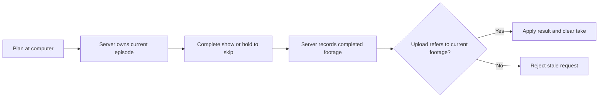

# Preventing duplicate production uploads

The festival production connects a physical show to the existing creator-computer upload flow. Its engineering problem is keeping that transition consistent when controls or upload requests are repeated.

The implementation described here is based on Luau source exports and recorded Studio checks from September 14, 2026.

## Implementation

The server keeps a planned production and identifies the active festival episode. Completion checks that the session still belongs to the current plan before recording completed footage. The computer sends the selected footage identity back to the creator service; the service checks that it matches the current, completed episode.

An eligible upload applies the existing video result and clears the pending production and footage. An old request therefore cannot reuse the now-consumed take through this checked path. Separately, show controls are checked against the active session and sequence so stale controls cannot advance a different show.



Simplified pseudocode illustrating the flow:

```text
when a show completes:
    require the session to match the current planned episode
    mark that production filmed
    store completed footage for that episode

when the computer requests an upload:
    require completed footage for the current production
    require the requested identity to match that footage
    require access to the player's owned workstation
    apply the existing video result
    clear the pending production and completed footage
```

## Design tradeoff

One current production gives the player a clear next action: finish, cancel, or upload. It also gives the server a small amount of state to validate. The cost is that the player cannot queue several unfinished productions. Clearing a take after its result is applied protects the checked live-session flow, but does not by itself prove an atomic durable transaction across a server crash or failed save.

## Verification

The September 14 development checks recorded the following results:

| Check | Observed result | Scope |
| --- | --- | --- |
| Complete the festival | Footage uploaded through the existing creator service | Studio development run; upload invoked through an isolated QA helper |
| Brief press versus deliberate hold | Brief E press kept the show running; a simulated 1.5-second hold completed a skipped take | Desktop input path |
| Upload the skipped take again | Initial upload succeeded; repeat was rejected; video count increased by one | The exercised footage-reuse path |
| Return control after skipping | Camera returned to normal and cinematic HUD closed | Recorded desktop observation |

Earlier checks on the same production flow also recorded rejection of wrong-session and old-sequence controls. Those checks preceded the latest presentation changes.

These were isolated development tests. Test changes were prevented from persisting, and the captured profile state was restored afterward.

## Further testing

Crash recovery, cross-server races, simultaneous uploads, and native touch input were not established by these checks. The next useful verification would exercise repeated uploads and interrupted connections through the real computer UI on desktop and mobile, while checking both visible results and saved state.
